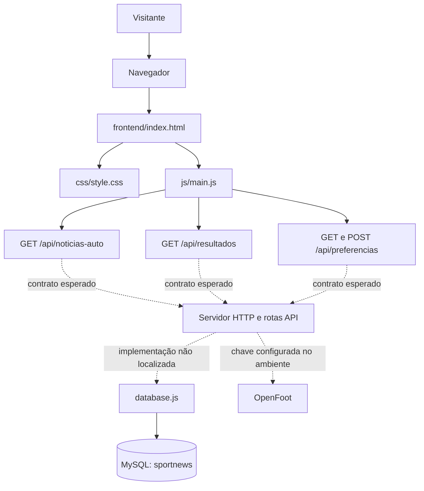

# SPORTNEWS

Portal web de futebol para consultar notícias, acompanhar resultados e personalizar a experiência com campeonatos e favoritos.

> **Status técnico:** em desenvolvimento. O frontend está documentado a partir dos arquivos encontrados em `backend.zip`. A implementação do servidor HTTP/API e o schema do banco não foram encontrados no pacote analisado. Consulte [Status técnico](docs/ROADMAP.md) antes de tentar publicar o projeto como aplicação completa.

## Sumário

- [Visão geral](#visão-geral)
- [Funcionalidades identificadas](#funcionalidades-identificadas)
- [Tecnologias e dependências](#tecnologias-e-dependências)
- [Arquitetura](#arquitetura)
- [Estrutura do repositório](#estrutura-do-repositório)
- [Configuração](#configuração)
- [Contrato da API](#contrato-da-api)
- [Banco de dados](#banco-de-dados)
- [Execução e limitações](#execução-e-limitações)
- [Segurança](#segurança)
- [Documentação complementar](#documentação-complementar)

## Visão geral

O SPORTNEWS é uma interface web focada em futebol brasileiro e internacional. A página apresenta notícias, jogos/resultados e filtros por campeonato. O visitante também pode informar o time brasileiro, o time europeu e o jogador favorito para personalizar o painel.

A interface é construída com HTML, CSS e JavaScript sem framework de frontend. O JavaScript consulta rotas HTTP sob o prefixo `/api` e atualiza os componentes da página.

## Funcionalidades identificadas

| Área | Comportamento observado no frontend |
|---|---|
| Navegação | Links para Início, Notícias, Resultados e Campeonatos |
| Campeonatos | Filtro de resultados por liga, incluindo Brasileirão, Libertadores, Sul-Americana, Premier League, LaLiga, Serie A, Bundesliga e Ligue 1 |
| Notícias | Consulta `GET /api/noticias-auto` e renderização de até 12 notícias |
| Resultados | Consulta `GET /api/resultados`, cards de partidas e botão para atualizar manualmente |
| Preferências | Leitura e gravação de time brasileiro, time europeu e jogador favorito |
| Atualização periódica | Notícias e resultados são recarregados a cada 60 segundos |
| Estados da interface | Estados de carregamento, lista vazia e mensagem de erro |

Essas funcionalidades descrevem o comportamento do frontend encontrado no ZIP. Não significam que as rotas de backend estejam operacionais.

## Tecnologias e dependências

| Tecnologia | Evidência no repositório |
|---|---|
| HTML5 | `backend/frontend/index.html` |
| CSS3 | `backend/frontend/css/style.css` |
| JavaScript | `backend/frontend/js/main.js` |
| Node.js | Estrutura de dependências Node presente no ZIP |
| Express | Pacote presente no lockfile interno |
| MySQL | Conector `mysql2` em `backend/database.js` |
| dotenv | Carregamento de variáveis de ambiente em `database.js` |
| OpenFoot | Variáveis `OPENFOOT_API_KEY` e `OPENFOOT_EVENTS_ENABLED` no arquivo de exemplo |

O ZIP contém versões instaladas de pacotes como Express, mysql2, dotenv, cors, rss-parser, bcrypt, jsonwebtoken e nodemon. Como não foi encontrado um `package.json`, não é possível confirmar quais deles são dependências diretas, quais scripts eram usados ou reproduzir a instalação de forma confiável.

## Arquitetura

O diagrama abaixo diferencia os componentes existentes dos componentes que o frontend espera encontrar. A caixa da API está tracejada porque os handlers e o ponto de entrada do servidor não foram encontrados no pacote analisado.



## Estrutura do repositório

O código da aplicação está atualmente empacotado em `backend.zip`, na raiz do GitHub:

```text
sport-news/
├── README.md
└── backend.zip
    └── backend/
        ├── .env
        ├── .env.example
        ├── .gitignore
        ├── database.js
        ├── LEIA-ANTES.txt
        ├── frontend/
        │   ├── index.html
        │   ├── css/
        │   │   └── style.css
        │   └── js/
        │       └── main.js
        └── node_modules/
            └── .package-lock.json
```

**Observação:** essa é a estrutura do pacote examinado, não uma recomendação de organização. O ZIP também contém dependências de terceiros em `node_modules`. Não foram localizados no pacote `package.json`, arquivo de inicialização do servidor, handlers das rotas ou scripts SQL de criação das tabelas.

## Configuração

O arquivo `backend/.env.example` define as seguintes variáveis:

| Variável | Finalidade | Exemplo |
|---|---|---|
| `OPENFOOT_API_KEY` | Chave da integração OpenFoot | Preencher com uma chave válida |
| `OPENFOOT_EVENTS_ENABLED` | Habilitação opcional de eventos | `false` por padrão |
| `DB_HOST` | Host do MySQL | `localhost` |
| `DB_USER` | Usuário do MySQL | `root` em ambiente local |
| `DB_PASSWORD` | Senha do MySQL | Definir localmente |
| `DB_NAME` | Nome do banco | `sportnews` |

O conector atualmente usa `DB_HOST`, `DB_USER`, `DB_PASSWORD` e `DB_NAME`. Não foi observado suporte explícito a `DB_PORT` em `database.js`.

Nunca publique o arquivo `.env`. O pacote versionado contém uma entrada com esse nome; consulte [Segurança](docs/SEGURANCA.md) e trate as credenciais como potencialmente expostas.

## Contrato da API

O frontend espera três rotas:

| Método | Rota | Responsabilidade esperada |
|---|---|---|
| GET | `/api/noticias-auto` | Retornar notícias |
| GET | `/api/resultados` | Retornar jogos e placares |
| GET | `/api/preferencias` | Carregar preferências |
| POST | `/api/preferencias` | Salvar preferências |

Os formatos de resposta compatíveis com o código cliente estão descritos em [Contrato da API](docs/API.md). Os endpoints são requisitos observados no frontend; a implementação do servidor não foi localizada no ZIP.

## Banco de dados

O arquivo `database.js` cria uma conexão MySQL usando `mysql2`, com o nome de banco padrão `sportnews` e charset `utf8mb4`.

Não foi encontrado um schema SQL, migrations ou definição verificável das tabelas. Consulte [Banco de dados](docs/BANCO-DE-DADOS.md) para os detalhes confirmados e as pendências.

## Execução e limitações

O arquivo `LEIA-ANTES.txt` recomenda executar `npm install` e `npm start` dentro de `backend`. Entretanto, o pacote analisado não contém `package.json` nem um servidor de entrada identificável. Portanto, esses comandos não podem ser garantidos como funcionais no estado atual do repositório.

É possível visualizar a interface separadamente com um servidor estático, mas as chamadas para `/api` falharão enquanto o backend não estiver disponível. O procedimento e as limitações estão em [Instalação e execução](docs/INSTALACAO.md).

## Segurança

Antes de disponibilizar o projeto publicamente:

1. Revogue e gere novamente qualquer chave ou senha que possa ter sido incluída no ZIP.
2. Remova o arquivo `.env` do pacote e do histórico do Git, se aplicável.
3. Mantenha segredos exclusivamente em variáveis de ambiente do serviço de hospedagem.
4. Implemente validação de entrada, consultas parametrizadas, controle de origem e tratamento de erros no backend.
5. Valide URLs externas antes de renderizá-las como links.

Veja [Segurança](docs/SEGURANCA.md).

## Documentação complementar

- [Arquitetura e fluxo da aplicação](docs/ARQUITETURA.md)
- [Contrato da API](docs/API.md)
- [Banco de dados MySQL](docs/BANCO-DE-DADOS.md)
- [Instalação e execução](docs/INSTALACAO.md)
- [Segurança](docs/SEGURANCA.md)
- [Testes e qualidade](docs/TESTES.md)
- [Contribuição e padrão de desenvolvimento](docs/CONTRIBUICAO.md)
- [Status técnico e roadmap](docs/ROADMAP.md)

---

**Revisão documental:** 13/11/2026.  
**Fonte da análise:** branch `main`, README e conteúdo de `backend.zip`. A documentação não declara como implementados os componentes que não estão presentes no pacote.
