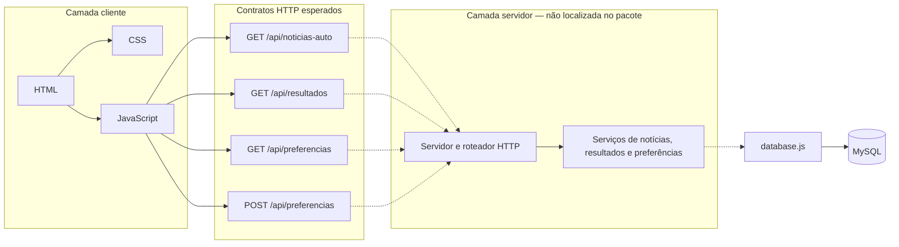
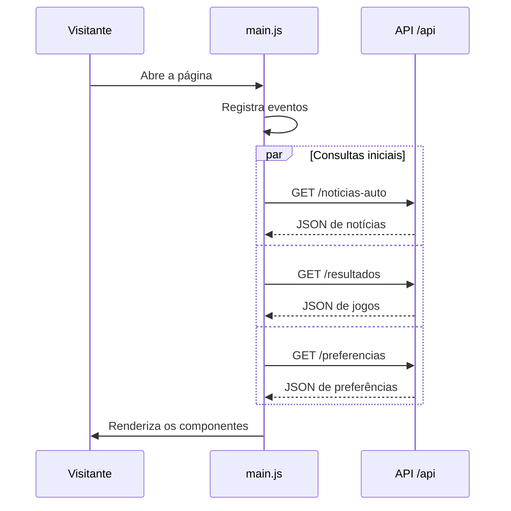

# Arquitetura do SPORTNEWS

## 1. Objetivo

Este documento descreve a arquitetura observável da interface e separa os componentes disponíveis daqueles que o frontend espera do servidor.

## 2. Visão lógica

A aplicação possui uma interface web estática. O arquivo `frontend/js/main.js` inicializa os componentes, registra eventos e solicita dados por HTTP usando o prefixo `/api`.

A linha tracejada representa uma dependência esperada, não uma integração validada. O ZIP não contém o servidor nem os handlers das rotas.

## 3. Componentes do frontend

### 3.1 Página principal

Arquivo: `backend/frontend/index.html`

Responsabilidades identificadas:

- definir cabeçalho e navegação;
- apresentar a seção de campeonatos;
- disponibilizar áreas de notícias e resultados;
- exibir o modal de preferências;
- carregar o arquivo `js/main.js`.

### 3.2 Folha de estilos

Arquivo: `backend/frontend/css/style.css`

Centraliza a apresentação visual da página. O CSS está incluído no pacote, mas não foi separado em módulos.

### 3.3 Controlador da interface

Arquivo: `backend/frontend/js/main.js`

Responsabilidades identificadas:

- iniciar a interface após `DOMContentLoaded`;
- registrar eventos dos filtros e botões;
- carregar notícias e resultados;
- preencher, abrir, fechar e salvar preferências;
- renderizar cards e mensagens de estado;
- atualizar notícias e resultados a cada 60 segundos.

O código mantém `resultadosAtuais` e `noticiasAtuais` em memória durante a sessão da página. Não foi identificada persistência local desses arrays.

## 4. Inicialização e carregamento

Na inicialização, o frontend configura menus e formulários e executa em paralelo as consultas de notícias, resultados e preferências.

A sequência acima representa o fluxo esperado pelo cliente. A comunicação real depende de um servidor que implemente as rotas.

## 5. Regras de interface identificadas

### Notícias

- Consulta `GET /api/noticias-auto`.
- Aceita resposta como array ou objeto com `noticias` ou `data`.
- Renderiza até 12 registros.
- Reconhece aliases para título, descrição, fonte, categoria e URL.
- Exibe estado de carregamento, erro ou lista vazia.

### Resultados

- Consulta `GET /api/resultados`.
- Aceita resposta como array ou objeto com `resultados` ou `data`.
- Renderiza equipes, escudos, campeonato, fase, horário, status e placar.
- Considera informações opcionais de intervalo, placar agregado e classificação.
- Permite atualizar manualmente e filtrar a lista por campeonato.

### Preferências

- Consulta `GET /api/preferencias`.
- Aceita os nomes `timeBrasil`, `timeEuropa`, `jogadorFavorito` e variantes em snake_case ao carregar dados.
- Envia `POST /api/preferencias` com os campos em camelCase.
- O frontend considera qualquer resposta HTTP de sucesso como gravação concluída.

Não foi identificado mecanismo de autenticação no frontend fornecido. Não se deve presumir que as preferências estejam isoladas por usuário.

## 6. Atualização periódica

O cliente executa uma atualização a cada 60 segundos para notícias e resultados. A rotina não inclui preferências. O botão de atualização manual atua sobre os resultados.

## 7. Dependências externas

O arquivo `.env.example` declara `OPENFOOT_API_KEY` e `OPENFOOT_EVENTS_ENABLED`. Isso indica configuração prevista para uma integração de dados esportivos, mas o código consumidor dessa configuração não foi encontrado. A documentação da API externa, limites de uso e mapeamento de respostas ainda precisam ser adicionados quando a integração for recuperada.

## 8. Limitações arquiteturais verificadas

| Item | Situação |
|---|---|
| HTML, CSS e JavaScript do frontend | Presente no ZIP |
| Conector MySQL | Presente em `database.js` |
| Servidor HTTP | Não localizado |
| Rotas de notícias e resultados | Não localizadas |
| Rotas de preferências | Não localizadas |
| Schema e migrations | Não localizados |
| Manifesto `package.json` | Não localizado |
| Testes automatizados | Não localizados |
| Configuração de deploy | Não localizada |

## 9. Recomendações de arquitetura

1. Extrair o código do ZIP e versionar a aplicação em pastas navegáveis.
2. Criar um ponto de entrada único do servidor e registrar explicitamente as rotas.
3. Separar rotas, serviços, repositórios de dados e integração externa.
4. Usar pool de conexões MySQL, com encerramento controlado.
5. Definir contratos JSON versionados e validação de entrada no servidor.
6. Persistir preferências com chave de usuário somente depois de implementar autenticação real.
7. Adicionar testes unitários e testes de integração para os contratos HTTP.
